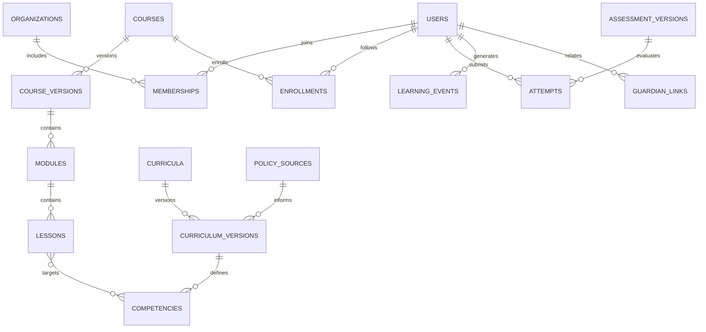

# L’ENSEIGNEMENT — Cahier directeur de conception et de développement

**Version :** 0.1.0 · **Date :** 27 octobre 2026 · **Statut :** document de cadrage technique initial (proposition à valider)  
**Périmètre :** Côte d’Ivoire · Enseignement préscolaire, primaire, secondaire général, enseignement technique, alphabétisation, éducation non formelle et formation continue.  
**Positionnement :** plateforme numérique éducative modulaire, inclusive, ludique, sécurisée et utilisable à faible débit.  
**Important :** « L’Enseignement » est une dénomination de projet ; disponibilité de la marque et des domaines, autorisations institutionnelles, droits sur les contenus et habilitations de délivrance de titres à vérifier avant lancement public. Il ne s’agit pas d’un produit officiellement agréé par le MENAET.

---

## 0. Décisions structurantes

1. **Un noyau commun, plusieurs branches métier** : identité, référentiels, contenus, progression, évaluations, statistiques et traçabilité communs ; espaces pédagogiques propres à chaque cycle et filière.
2. **Une architecture de monolithe modulaire en première phase** : modules isolés et contrats explicites, évènements métier ; extraction éventuelle de services seulement après mesure des besoins.
3. **Mobile-first, offline-first sur les parcours essentiels** : PWA installable, cache maîtrisé, téléchargement de packs, synchronisation différée, mode texte/audio faible débit.
4. **Référentiels versionnés** : programmes, niveaux, compétences et réformes administrables, historisés, avec dates d'effet ; ne jamais figer une réforme dans du code.
5. **Séparation forte des responsabilités** : portail public, apprentissage, production éditoriale, tutorat, administration, contrôle qualité, analytique anonymisée.
6. **Protection renforcée des mineurs** : minimisation, cloisonnement, modération, consentements et bases légales appropriées, interdiction du profilage commercial.
7. **Pas de certification officielle supposée** : badges internes et attestations de participation clairement distingués des diplômes ou certifications reconnus par l’État.
8. **Co-construction pédagogique** : validation des contenus avec les directions compétentes, enseignants, formateurs techniques, alphabétiseurs et apprenants.

### 0.1 Questions à arbitrer avant la production

| Décision | Proposition par défaut | Autorité/partie prenante |
|---|---|---|
| Statut de la plateforme | Projet indépendant, interopérable avec le secteur public | Porteur + tutelle si partenariat |
| Hébergement | Région offrant conformité, sécurité et garanties contractuelles ; priorité à la localisation applicable | Juridique, DPO, RSSI |
| Modèle économique | Accès gratuit aux fondamentaux ; offres institutions/partenaires distinctes et transparentes | Gouvernance |
| Identifiant élève | UUID interne ; correspondance avec identifiants administratifs seulement par accord | DSI / administration |
| Organismes certificateurs | Aucun diplôme d’État émis par défaut | Autorités habilitées |
| Langues | Français initial ; interface et contenus audio multilingues extensibles | Comités pédagogiques |
| IA | Optionnelle, désactivée par défaut pour données de mineurs ; tests avant déploiement | DPO, RSSI, comité éthique |

---

## 1. Vision, objectifs et indicateurs de résultats

**Vision** : permettre à chaque personne d'apprendre, de progresser, de démontrer ses compétences et de trouver des passerelles, du premier apprentissage à la qualification technique, quels que soient son âge, sa localisation, son équipement ou son niveau de littératie.

**Objectifs mesurables (cibles initiales de conception, et non statistiques nationales)** :
- ≥ 95 % des parcours critiques terminables sur smartphone Android d'entrée de gamme.
- LCP ≤ 2,5 s au 75e percentile sur pages optimisées, dans un profil réseau de référence documenté ; CLS ≤ 0,1 ; INP ≤ 200 ms.
- Taux de réussite de synchronisation après reconnexion ≥ 99,5 % sur jeux de tests.
- ≥ 90 % de couverture automatisée des parcours d'autorisation sensibles par cas d'intégration.
- 100 % des contenus publiés dotés d'un référentiel, d'un statut de validation, d'une version et d'un propriétaire éditorial.
- Mesures éducatives : compétences initiales/finales, progression par cohorte, rétention à 7/30 jours, remédiation effective ; analyses agrégées avec seuils de confidentialité.

**Non-objectifs du MVP** : logiciel national de gestion scolaire exhaustif, gestion des concours officiels, délivrance autonome de diplômes, réseau social ouvert aux mineurs, marketplace publique non modérée, surveillance biométrique.

---

## 2. Ancrage dans les réformes ivoiriennes

Les correspondances suivantes sont des **exigences de conception proposées**, pas l'affirmation que les autorités ont mandaté ou validé la plateforme.

| Politique/programme | Éléments vérifiés | Traduction fonctionnelle |
|---|---|---|
| **PNAPAS** | Dispositif hybride de formation, **7 unités** : lecture-écriture CP, mathématiques CP, remédiation CE/CM, lecture-écriture CE1, mathématiques CE1, français CE2, mathématiques CE2 ; tutorat, suivi, ressources et collaboration. Le portail emploie des développements variables de l'acronyme : retenir le libellé de référence de la DPFC après validation. | Parcours enseignants tutorés ; fiches de séance ; observation de classe ; évaluations diagnostiques ; aide à la remédiation ; tableaux de suivi ; import de ressources seulement avec droits/accords. |
| **EGENA** | Réformes de qualité, inclusion, gouvernance, transformation numérique et révision des curricula. | Référentiels curriculaires versionnés, suivi des acquis, tableaux territoriaux, contenus inclusifs. |
| **Réforme curriculaire et nouveaux programmes** | Expérimentation et extension annoncées ; coexistence de versions possibles selon école/année. | Associer chaque parcours à programme, cohorte, année scolaire, zone et date d'effet ; migration contrôlée, sans écraser les historiques. |
| **Stratégie nationale de digitalisation de l'éducation / SIGE** | Transformation numérique et extension du système d'information sectoriel. | API interopérables documentées ; connecteurs uniquement autorisés ; dictionnaire de données et échanges audités. |
| **SNA 2026–2035** | Stratégie nationale d'alphabétisation présentée en septembre 2026 ; territorialisation et inclusion. | Parcours adultes accessibles par audio, lecture fonctionnelle, calcul du quotidien, suivi communautaire, centres, facilitateurs, apprentissage intergénérationnel. |
| **PNAENF / éducation non formelle** | Politique nationale d'alphabétisation et d'éducation non formelle travaillée ; enfants hors système, passerelles et centres communautaires. | Classes passerelles, équivalences à valider, suivi des centres et réintégration accompagnée. |
| **PND 2026–2030** | Accent sur le capital humain, l'EFTP, l'alphabétisation, l'employabilité, l'apprentissage intergénérationnel et les passerelles. | Cartographie des compétences, ateliers techniques, projets métiers, passerelles formation/insertion et indicateurs territoriaux. |
| **Enseignement technique** | Développement des filières techniques et des compétences professionnelles ; nécessité d'articuler formation théorique, travaux pratiques et monde professionnel. | Référentiels métier, sécurité en atelier, carnet de compétences, projets, équipements, stages/entreprises et évaluations pratiques. |
| **Gouvernance MENAET 2026** | Décret d'organisation n° 2026-509 du 5 août 2026 signalé sur le portail ministériel. | Référentiel institutionnel paramétrable, circuits de validation à confirmer avec les textes en vigueur et les directions concernées. |

**Précautions** : vérifier chaque document normatif dans sa version officiellement applicable avant paramétrage ; distinguer politique, pilote, annonce et obligation juridique. Le projet n'utilise pas les logos, noms ou identifiants officiels sans autorisation écrite.

### 2.1 Traçabilité des réformes
Chaque règle porte `policy_source_id`, `policy_version`, `status` (`draft`, `approved`, `effective`, `repealed`), `effective_from`, `effective_until`, `approved_by` et un journal d'audit. Un **registre des réformes** dans l'administration permet de montrer quel contenu et quelle compétence ont été affectés par un changement.

---

## 3. Architecture métier : du noyau aux branches

```text
                         L'ENSEIGNEMENT
                                │
                ┌───────────────┴───────────────┐
                │       NOYAU TRANSVERSAL       │
                │ Identité · Organisation · RBAC│
                │ Curricula · Contenus · LMS    │
                │ Évaluations · Progression     │
                │ Notifications · Recherche     │
                │ Analytique · Audit · Sécurité  │
                └───────────────┬───────────────┘
        ┌─────────────┬─────────┼──────────┬─────────────┐
        │             │         │          │             │
  Préscolaire/    Secondaire  Technique  Alphabétisation  Formation
  primaire        général    & métiers  & non formelle   enseignants
        │             │         │          │             │
  PNAPAS,         Sciences,  Filières,  Adultes,        Tutorat,
  remédiation     langues    ateliers,  audio,          observation,
  lecture/calcul  examens*   projets    passerelles     ressources
```
`*` Préparation pédagogique uniquement, pas de gestion d'examens d'État sans convention.

### 3.1 Branches et fonctions

**A. Préscolaire et primaire** — activités courtes, lecture syllabique et compréhension, numératie, exercices multisensoriels, bibliothèque d'histoires locales, diagnostic des acquis, séquences PNAPAS orientées enseignants, remédiation ciblée, suivi familles accessible sans exposer des données d'autres enfants.

**B. Secondaire général** — cours par discipline/classe, sciences interactives, devoirs formatifs, annales utilisées légalement, laboratoires virtuels, parcours de révision, clubs de sciences, orientation.

**C. Enseignement technique** — catalogues de filières et spécialités, compétences métier, prérequis de sécurité, séquences démonstration/pratique, projets d'atelier, carnet de travaux pratiques, check-lists EPI et gestes sûrs, évaluations en situation, grille d'observation du maître/formateur, portfolio photo soumis à consentement et à contrôle ; partenariats entreprises et stages avec habilitations séparées. **La pratique réelle supervisée demeure indispensable.**

**D. Alphabétisation et éducation non formelle** — interface « écouter d'abord », pictogrammes, navigation vocale, niveaux personnalisés, lecture/écriture/calcul fonctionnels, situations du quotidien (marché, transport, santé publique non médicale, agriculture, métier), sessions collectives hors ligne, tuteur communautaire, aide à la réintégration/aux passerelles. Les langues locales sont **à définir avec linguistes et équipes pédagogiques** ; ne pas improviser des normes d'écriture.

**E. Formation continue des enseignants et alphabétiseurs** — parcours hybrides, autoformation tutorée, observations de pratique, communautés modérées, rubriques de remédiation, suivi de formation, attestations non officielles ou certifications partenariales autorisées.

**F. Parents, établissements, territoires et partenaires** — informations pédagogiques limitées au lien légitime ; gouvernance école/centre/territoire ; statistiques agrégées ; intégrations administratives conventionnées.

### 3.2 Matrice des profils

| Rôle | Capacités clés | Limites |
|---|---|---|
| Visiteur | Parcourir catalogue et contenus publics | Aucune donnée d'apprenant |
| Apprenant mineur | Apprendre, passer exercices, suivre progrès | Pas de discussion publique ni publication libre |
| Apprenant adulte | Apprendre, choisir ses parcours, voir portfolio | Accès à ses seules données |
| Parent/tuteur légal | Voir synthèse autorisée des enfants liés | Pas d'accès aux notes d'autres enfants |
| Enseignant/formateur | Préparer, suivre groupes autorisés, commenter | Aucun accès hors périmètre de groupe |
| Alphabétiseur | Animer sessions et suivre centre autorisé | Accès local uniquement |
| Chef d'établissement/centre | Gérer structure et synthèse | Pas d'accès transversal sans mandat |
| Référent pédagogique | Réviser et approuver contenus | Pas de privilège sécurité globale |
| Modérateur | Traiter signalements | Accès minimal aux contenus signalés |
| Administrateur territorial | Statistiques et paramétrage délégué | Accès aux seuls territoires autorisés |
| Administrateur plateforme | Configuration et exploitation | Pas de lecture par défaut de contenus personnels |
| Auditeur / DPO / RSSI | Contrôles à droits et durées définis | Accès motivé, journalisé, révocable |

**Principe** : RBAC + ABAC (rôle + territoire + organisation + cohorte + relation légale + action + finalité) ; refus par défaut.

---

## 4. Expérience utilisateur, fluidité et dimension ludique

### 4.1 Principes de conception
- **Premier geste utile en < 3 interactions** : « Je veux apprendre », « Je veux enseigner », « Je veux me former à un métier », « Je veux apprendre à lire ».
- Onboarding progressif : choix du public, de la langue, du niveau, diagnostic facultatif puis premier exercice ; inscription différable pour ressources publiques.
- Cartes de cours très lisibles, navigation par tâche et niveau ; progression visible ; bouton « reprendre » permanent.
- Activités de 3 à 8 minutes pour microapprentissage ; pause/reprise, sous-titres et transcription.
- Aucun contenu essentiel exclusivement en vidéo ; version audio/texte et mode compressé.
- Gamification **non coercitive** : étapes, badges pédagogiques, quêtes par compétence, récits, défis coopératifs ; pas de classement public des mineurs, pas de sanctions de séries de connexion, pas de récompenses incitant à payer.
- Remédiation bienveillante : expliquer l'erreur, proposer un exemple, varier le support, répéter sans stigmatiser.
- Accessibilité WCAG 2.2 AA visée ; navigation clavier, lecteurs d'écran, contraste, taille de police, sous-titres, langage clair ; alternative non vocale.

### 4.2 Charte graphique initiale (à tester avec utilisateurs)

| Usage | Couleur | Hex |
|---|---|---|
| Primaire / action | Vert profond | `#146B46` |
| Interaction / focus | Vert vif accessible | `#217A53` |
| Accent / réussite | Orange chaleureux | `#E97824` |
| Texte principal | Bleu nuit | `#17253B` |
| Fond général | Ivoire très clair | `#FAFAF5` |
| Surface | Blanc | `#FFFFFF` |
| Bordure | Gris doux | `#D9E1E5` |
| Erreur | Rouge profond | `#A52A32` |
| Information | Bleu | `#215C9A` |

**Attention** : vérifier les contrastes *sur les couples réels fond/texte*, ne pas supposer qu'une couleur est conforme par elle-même. Palette inspirée du contexte ivoirien, **sans reproduire d'identité institutionnelle officielle**.

**Typographie** : `Inter` ou `Atkinson Hyperlegible` pour l'interface ; `Noto Sans` comme secours multilingue. Sources et licences à vérifier ; corps 16–18 px, interligne ≥ 1,5, zones tactiles ≥ 44 × 44 px comme objectif ergonomique. Espacements sur échelle 4/8 px ; rayons 12–20 px ; animations douces (150–250 ms), désactivables via `prefers-reduced-motion`.

**Composants** : `AppShell`, `AudienceSelector`, `CourseCard`, `SkillMap`, `AudioLessonPlayer`, `OfflineBadge`, `QuizRunner`, `PracticeRubric`, `ProgressRing`, `TeacherDashboard`, `SyncStatus`, `SafetyReportButton`, `ConsentGate`.

### 4.3 Expériences emblématiques
1. **Défi lecture** : écouter → reconnaître → lire → comprendre → réessayer avec indice.
2. **Marché-école** (alphabétisation) : comprendre prix, quantités, monnaie et consignes en mode audio.
3. **Atelier virtuel de base** (technique) : reconnaître les pièces, respecter EPI, ordonner les gestes ; le module n'autorise jamais une manipulation physique risquée sans encadrement.
4. **Boîte à outils PNAPAS** : sélectionner niveau/compétence, visualiser fiche, conduire activité, noter observation et choisir remédiation.

---

## 5. Architecture technique cible

### 5.1 Technologies recommandées

| Couche | Choix initial | Justification |
|---|---|---|
| Frontend web/PWA | Next.js + React + TypeScript | UI mobile, SEO portail, SSR ciblé |
| Design system | Tailwind CSS + composants accessibles contrôlés | Cohérence et rapidité de développement |
| API | NestJS + TypeScript, REST + OpenAPI | Modules, validation, contrats |
| Base transactionnelle | PostgreSQL (version maintenue) | Intégrité, JSONB mesuré, index et RLS si approprié |
| Accès BD | Prisma ou Drizzle (choisir un seul) | Migrations et typage |
| Cache / queues | Redis + BullMQ | Limitation de charge et traitements différés |
| Objets | Stockage S3-compatible chiffré | Vidéos, PDF, audio et fichiers |
| Recherche | PostgreSQL FTS d'abord ; moteur dédié plus tard | Évite la complexité prématurée |
| Identité | OIDC/OAuth2, fournisseur IAM maîtrisé (ex. Keycloak) | MFA, fédération future, sessions |
| Analyse pédagogique | Événements pseudonymisés + agrégats | Suivi sans traçage excessif |
| Observabilité | OpenTelemetry, Prometheus/Grafana, traces structurées | Mesure SLO et incidents |
| CI/CD | GitHub Actions / GitLab CI, conteneurs, IaC | Reproductibilité |
| Tests E2E | Playwright | Navigateurs, mobile, parcours clés |
| Tests sécurité | Semgrep/CodeQL, Trivy, ZAP en environnement dédié | Détection continue |

**Règle de conception** : privilégier des versions LTS et verrouiller les dépendances après contrôle des compatibilités ; la présente note ne certifie pas les versions les plus récentes.

### 5.2 Topologie

```text
Navigateur / PWA / Android WebView éventuel
          │ HTTPS + CDN + WAF + anti-DDoS
          ▼
      Reverse proxy
          │
    ┌─────┴─────┐
    ▼           ▼
Portail Next.js API NestJS ────── IAM OIDC
                │
    ┌───────────┼────────────┬───────────────┐
    ▼           ▼            ▼               ▼
PostgreSQL    Redis       Object store    Workers
    │           │            │               │
    └─────── event outbox ────┴──── telemetry ┘
```

**Bounded contexts (modules NestJS)** : `auth`, `organizations`, `people`, `guardianship`, `catalog`, `curriculum`, `content`, `learning`, `assessment`, `remediation`, `technical`, `literacy`, `teacher-training`, `collaboration`, `moderation`, `notifications`, `credentials`, `analytics`, `integrations`, `policy-registry`, `audit`.

### 5.3 Contrats internes
- Les modules publient des évènements via **outbox transactionnelle** (`EnrollmentCreated`, `LessonCompleted`, `AssessmentSubmitted`, `SkillValidated`, `ContentPublished`, `ConsentRevoked`).
- Les commandes sont idempotentes ; chaque requête sensible prend une `Idempotency-Key`.
- Pas d'accès direct d'un module aux tables privées d'un autre sans contrat explicite ; transactions courtes ; tâches lourdes asynchrones.
- API sous `/api/v1`; OpenAPI générée ; pagination curseur ; format d'erreur stable (`code`, `message`, `trace_id`, `details` sécurisés).
- Multi-établissements : `organization_id`, `tenant_id` (si multi-tenant), politiques de portée obligatoires ; tests systématiques anti-fuite entre tenants.

### 5.4 Hors ligne et synchronisation
- Service worker : précache de l'interface, cache contrôlé des ressources autorisées, jamais de secrets ; stratégie stale-while-revalidate pour contenus publics.
- IndexedDB local chiffré lorsque faisable mais **ne pas présumer une protection totale sur appareil partagé** ; minimiser données stockées.
- Packs de cours signés/versionnés avec contrôles d'intégrité, dates d'expiration et révocation.
- File locale d'actions horodatées, UUID d'opération, compteur de version et reprise sur réseau intermittent.
- Résolution de conflits : progression monotone (max ou événements), brouillons avec réconciliation, notes/évaluations corrigées uniquement serveur ; signaler les conflits humains.
- Bouton « effacer mes données sur cet appareil », déconnexion locale et purge après révocation ; stratégie particulière pour appareils communautaires partagés.

---

## 6. Modèle de données — PostgreSQL

### 6.1 Principes
- UUID v7 ou UUID standards pour PK ; `created_at`, `updated_at`, `deleted_at` si effacement logique justifié ; `version` pour concurrence optimiste.
- Toute donnée personnelle rattachée à une finalité et une politique de conservation ; enregistrements pédagogiques et identités séparés selon les usages.
- Relations `tenant_id/organization_id` contrôlées ; FK et index composites ; clés étrangères entre modules uniquement après arbitrage d'architecture.
- Les résultats évaluatifs enregistrent **la version exacte du référentiel et de l'évaluation** utilisée.

### 6.2 Inventaire des tables (MVP et extension)

| Domaine | Tables principales | Champs/relations critiques |
|---|---|---|
| Identité | `users`, `profiles`, `auth_identities`, `sessions`, `consents` | `users.id`, `status`, `oidc_subject`, `consent_type`, `legal_basis`, `revoked_at` |
| Structures | `organizations`, `organization_units`, `regions`, `sites`, `memberships` | relation parent/enfant ; périmètre territorial ; `organization_id` |
| Autorisations | `roles`, `permissions`, `role_grants`, `resource_scopes` | permissions granulaires + `scope_type/scope_id`, expiration |
| Familles | `guardian_links` | autorité du tuteur, statut de vérification, révocation |
| Référentiels | `policy_sources`, `curricula`, `curriculum_versions`, `levels`, `subjects`, `competencies`, `competency_edges` | version, validité, prérequis, lien source officiel |
| Catalogue | `courses`, `course_versions`, `modules`, `lessons`, `lesson_assets`, `learning_paths` | public cible, langue, licence, auteur, approbation |
| Apprentissage | `cohorts`, `enrollments`, `lesson_progress`, `learning_events`, `offline_sync_ops` | unicité apprenant/parcours, horodatage, idempotence |
| Évaluation | `question_banks`, `questions`, `assessment_versions`, `assessment_items`, `attempts`, `responses`, `rubric_scores` | barème figé, tentatives, évaluateur et audit |
| PNAPAS / remédiation | `diagnostic_sessions`, `skill_gaps`, `remediation_plans`, `class_observations`, `tutoring_sessions` | UF, enseignant/formateur, preuve, recommandation |
| Technique | `trade_families`, `trades`, `workshop_projects`, `equipment_types`, `safety_checklists`, `practical_assessments`, `internships`, `industry_partners` | compétences, encadrement, sécurité, habilitation |
| Alphabétisation | `literacy_centers`, `facilitators`, `literacy_paths`, `group_sessions`, `functional_scenarios`, `bridge_referrals` | audio, langue, centre, étape, passerelle |
| Collaboration | `discussion_threads`, `posts`, `reports`, `moderation_cases` | accès restreint, statut modération |
| Attestations | `badges`, `credential_templates`, `issued_credentials`, `credential_verifications` | émetteur, nature, signature, révocation |
| Exploitation | `notifications`, `jobs`, `outbox_events`, `audit_logs`, `integration_mappings`, `feature_flags` | tentative, transport, corrélation, traçabilité |

### 6.3 Schéma relationnel simplifié



### 6.4 SQL de départ — extrait exécutable à adapter aux migrations

```sql
CREATE EXTENSION IF NOT EXISTS pgcrypto;
CREATE TABLE organizations (
  id uuid PRIMARY KEY DEFAULT gen_random_uuid(),
  name text NOT NULL,
  type text NOT NULL CHECK (type IN ('school','technical_center','literacy_center','authority','partner')),
  parent_id uuid REFERENCES organizations(id),
  created_at timestamptz NOT NULL DEFAULT now()
);
CREATE TABLE users (
  id uuid PRIMARY KEY DEFAULT gen_random_uuid(),
  oidc_subject text UNIQUE NOT NULL,
  account_type text NOT NULL CHECK (account_type IN ('minor','adult','staff')),
  status text NOT NULL DEFAULT 'active',
  created_at timestamptz NOT NULL DEFAULT now()
);
CREATE TABLE curricula (
  id uuid PRIMARY KEY DEFAULT gen_random_uuid(),
  code text NOT NULL UNIQUE,
  title text NOT NULL,
  branch text NOT NULL
);
CREATE TABLE curriculum_versions (
  id uuid PRIMARY KEY DEFAULT gen_random_uuid(),
  curriculum_id uuid NOT NULL REFERENCES curricula(id),
  version_label text NOT NULL,
  status text NOT NULL CHECK (status IN ('draft','approved','effective','retired')),
  effective_from date,
  source_uri text,
  UNIQUE(curriculum_id, version_label)
);
CREATE TABLE courses (
  id uuid PRIMARY KEY DEFAULT gen_random_uuid(),
  owner_organization_id uuid REFERENCES organizations(id),
  code text NOT NULL UNIQUE,
  title text NOT NULL,
  branch text NOT NULL,
  visibility text NOT NULL DEFAULT 'private'
);
CREATE TABLE enrollments (
  id uuid PRIMARY KEY DEFAULT gen_random_uuid(),
  user_id uuid NOT NULL REFERENCES users(id),
  course_id uuid NOT NULL REFERENCES courses(id),
  status text NOT NULL DEFAULT 'active',
  enrolled_at timestamptz NOT NULL DEFAULT now(),
  UNIQUE(user_id, course_id)
);
CREATE TABLE learning_events (
  id uuid PRIMARY KEY DEFAULT gen_random_uuid(),
  user_id uuid NOT NULL REFERENCES users(id),
  course_id uuid NOT NULL REFERENCES courses(id),
  event_type text NOT NULL,
  client_operation_id uuid NOT NULL,
  payload jsonb NOT NULL DEFAULT '{}'::jsonb,
  created_at timestamptz NOT NULL DEFAULT now(),
  UNIQUE(user_id, client_operation_id)
);
CREATE INDEX idx_learning_events_user_course_time
  ON learning_events(user_id, course_id, created_at DESC);
```

**Ne pas déployer ce fragment seul** : il manque notamment migrations, contrôle d'accès multi-tenant, politiques de conservation, tables de version de cours, intégrité éditoriale, RLS et audit. Les attributs sensibles n'ont volontairement pas été mis dans `users`.

### 6.5 Exemples d'API

```http
GET    /api/v1/catalog?branch=literacy&level=beginner
GET    /api/v1/courses/{courseId}
POST   /api/v1/enrollments
GET    /api/v1/me/learning-plan
POST   /api/v1/learning-events
POST   /api/v1/assessments/{versionId}/attempts
POST   /api/v1/offline/sync
GET    /api/v1/teacher/cohorts/{id}/progress
POST   /api/v1/content/{id}/submit-review
POST   /api/v1/content/{id}/approve
GET    /api/v1/policies/active
```

Chaque route a un contrat OpenAPI, vérification d'accès serveur, pagination, rate limit, validation de schéma, erreurs structurées et tests d'isolation.

---

## 7. Gouvernance des contenus et apprentissages

**Cycle éditorial obligatoire** : `brouillon → revue pédagogique → contrôle accessibilité → contrôle juridique/droits → validation → publication → révision → archivage`.

Chaque ressource comporte : public, âge/niveau, branche, compétences visées, objectifs, prérequis, durée, langue, accessibilité, provenance, licence, auteur, relecteur, approbateur, version, date d'effet, statut et procédure de retrait. Pour les contenus PNAPAS, liens vers les supports officiels ou réutilisation autorisée uniquement.

**Moteur de recommandation V1 explicable et déterministe** : diagnostic → lacunes de compétences → prérequis → remédiation → nouvel essai. Aucun classement opaque d'enfants ; l'enseignant peut corriger une orientation et en comprendre la justification.

**Validité pédagogique** : pilotes terrain, tests avec apprenants aux profils variés, revue des biais linguistiques et territoriaux, évaluation des progrès pré/post, comparaison de cohortes prudente et non punitive.

**IA éventuelle (phase ultérieure)** : assistance à préparation de fiches, génération de variantes d'exercices **à valider humainement**, accessibilité vocale contrôlée. Jamais de décision automatisée irrévocable sur orientation, notes officielles, exclusion ou certification ; interdiction d'entraîner des modèles tiers sur les données des mineurs sans base légale et garanties appropriées.

---

## 8. Sécurité, protection des données et sûreté

### 8.1 Références et obligations
- Loi ivoirienne **n° 2013-450 du 19 juin 2013** relative à la protection des données à caractère personnel et textes d'application : qualification des traitements, formalités éventuelles, rôles, transferts internationaux, droits, durées de conservation, notification selon droit applicable.
- Loi **n° 2013-451 du 19 juin 2013** relative à la lutte contre la cybercriminalité ; autres exigences contractuelles/réglementaires applicables.
- Référentiels OWASP ASVS et Top 10, bonnes pratiques NIST/ISO 27001 comme **cadres techniques**, non substituts à la loi.
- Analyse juridique locale nécessaire avant mise en production, particulièrement pour enfants, données scolaires, hébergement et transferts.

### 8.2 Mesures techniques obligatoires
1. **IAM** : OIDC, MFA obligatoire pour personnels privilégiés, MFA adaptative autres comptes, sessions courtes, rafraîchissement avec rotation, révocation, protection anti-bruteforce, récupération sécurisée.
2. **Contrôle d'accès** : privilège minimal, RBAC+ABAC côté serveur, RLS si justifiée et correctement testée, séparation des environnements, accès support just-in-time avec approbation.
3. **Chiffrement** : TLS 1.2+ (viser TLS 1.3), chiffrement au repos, KMS, rotation des secrets, sauvegardes chiffrées ; pas de secrets en dépôt.
4. **Applications** : CSP, HSTS, CSRF si cookies, CORS strict, requêtes paramétrées, contrôle d'upload antivirus/type/taille, échappement XSS, SSRF egress filtering, protections IDOR.
5. **Protection des mineurs** : pas de géolocalisation précise par défaut, pas de messagerie privée adulte–enfant non contrôlée, signalement facilité, modération humaine et procédure d'escalade de protection.
6. **Journalisation** : événements d'administration, d'accès et d'export ; journal inviolable et minimisé ; corrélation d'incident ; aucune donnée sensible dans traces.
7. **Disponibilité** : sauvegardes quotidiennes et incrémentales selon RPO cible, restauration testée, plan de continuité, basculement, anti-DDoS, quotas, limitation de débit.
8. **Chaîne logicielle** : SBOM, dépendances épinglées, signatures d'artefacts, scan de secrets, SAST/SCA/DAST, images minimales, CI avec permissions limitées.
9. **Conformité** : registre des traitements, analyse d'impact selon risques, contrats sous-traitants, politique de rétention, effacement/rectification, tests des droits, cartographie des flux.

### 8.3 Objectifs de résilience proposés
**SLO** 99,9 % de disponibilité mensuelle hors maintenance planifiée clairement annoncée ; **RPO** ≤ 1 heure et **RTO** ≤ 4 heures pour les services critiques, **sous réserve d'un budget et d'une architecture dimensionnés**. Exercices de restauration au moins trimestriels ; simulation d'incident avant mise en service.

### 8.4 Modèle de menace initial
| Menace | Mitigation | Test obligatoire |
|---|---|---|
| Accès à la fiche d'un autre enfant | ABAC + lien légal vérifié | IDOR inter-familles |
| Fuite inter-établissements | Isolation des périmètres | Tests multi-tenant |
| Vol de compte de formateur | MFA, alertes, révocation | Compte compromis simulé |
| Injection / XSS / upload malveillant | Validation et sandbox de fichiers | DAST + tests d'upload |
| Triche ou falsification hors ligne | Idempotence, serveur source de vérité | Rejeu/réordonnancement d'événements |
| Exposition sur appareil partagé | Sessions courtes, purge locale | Test de changement de profil |
| Usurpation de certificat | Signature et vérification d'émission | Document altéré/revoqué |
| Harcèlement ou diffusion de données | Modération, filtrage, signalement | Parcours de signalement E2E |

---

## 9. Performance, accessibilité et qualité

**Budgets initiaux** : JavaScript au premier chargement réduit et mesuré par route ; images AVIF/WebP et responsive ; audio compressé ; streaming vidéo adaptatif quand pertinent ; préchargement parcimonieux ; recherche côté serveur indexée. Mesurer sur appareils Android économiques réellement disponibles sur le terrain.

**SLO UX** : pages statiques CDN ; CDN média sous autorisation ; traitement des quiz même avec latence ; indicateurs de synchronisation explicites ; reprise idempotente ; gestion des erreurs avec solution de récupération.

**Accessibilité** : audit axe-core + manuel + utilisateurs, lecteurs d'écran, clavier, zoom 200–400 %, sous-titres, transcription, alternatives visuelles, police adaptable, écriture simple ; traductions revues par locuteurs.

**Observabilité** : p50/p95/p99 latence, taux 4xx/5xx, taux d'échec sync, conversion onboarding, abandons sur exercices (agrégés), temps de validation éditoriale, coût d'hébergement par 1 000 apprenants actifs.

---

## 10. Stratégie de tests (du composant au E2E)

### 10.1 Pyramide de tests
- **Unitaires** : scoring, prérequis, transitions, permissions, remédiation, règles de badges.
- **Intégration** : PostgreSQL réel éphémère, stockage, queues, événements outbox, migrations avant/après.
- **Contrats** : OpenAPI + consommateurs, compatibilité rétroactive.
- **E2E Playwright** : Chrome/Firefox/WebKit, profils mobile/desktop ; scénarios hors ligne et réseau lent.
- **Sécurité** : tests ABAC/IDOR obligatoires, pentest indépendant avant lancement ; SAST, SCA, ZAP dans CI.
- **Accessibilité** : axe et tests humains ; parcours vocal apprenant adulte ; contraste et clavier.
- **Charge** : k6/Locust (inscription, catalogue, quiz, vidéo, synchronisation) ; volumes réalistes fixés après pilote.
- **Résilience** : coupure de réseau, duplication événements, redémarrage worker, perte de cache, restauration base et rollback.

### 10.2 Scénarios E2E prioritaires (critères d'acceptation)

| ID | Scénario | Réussite attendue |
|---|---|---|
| E2E-01 | Apprenant découvre un cours public sur téléphone | Le premier exercice s'ouvre sans authentification si public |
| E2E-02 | Inscription mineur et association au tuteur | Aucun partage parental sans relation vérifiée |
| E2E-03 | PNAPAS : enseignant suit UF, passe quiz, formateur commente | Progression, correction et suivi cohérents |
| E2E-04 | Élève en difficulté suit une remédiation lecture | Diagnostic et post-test liés à la version de compétence |
| E2E-05 | Apprenant technique effectue simulation sécurité | Blocage du parcours pratique en cas d'échec de prérequis |
| E2E-06 | Adulte peu lecteur navigue exclusivement par audio | Leçon et quiz accessibles sans texte complexe |
| E2E-07 | Appareil perd le réseau pendant quiz | Brouillon conservé ; tentative synchronisée une fois |
| E2E-08 | Double envoi de progression hors ligne | Aucun doublon ni double attribution de badge |
| E2E-09 | Enseignant A tente d'accéder à cohorte B | `403` sans fuite de métadonnées |
| E2E-10 | Parent A tente d'ouvrir données de l'enfant B | Refus et évènement d'audit |
| E2E-11 | Rédacteur publie sans validation | Publication bloquée |
| E2E-12 | Contenu pédagogique révoqué | Plus d'accès nouveau ; cache invalidé selon politique |
| E2E-13 | Demande d'effacement de données | Workflow juridique, journal des actions et résultat conforme |
| E2E-14 | Certificat interne falsifié ou révoqué | Vérification indique invalidité sans exposer identité inutile |
| E2E-15 | Réseau 2G/3G simulé / mode data saver | Interface utilisable, alternatif texte/audio disponible |
| E2E-16 | Navigateur clavier/lecteur d'écran | Parcours essentiel sans obstacle bloquant |

### 10.3 Exemple Playwright

```ts
import { test, expect } from '@playwright/test';

test('un apprenant retrouve sa progression après reconnexion', async ({ page, context }) => {
  // Fixtures : utilisateur et cours de démonstration isolés, compte autorisé.
  await page.goto('/apprendre/demo');
  await context.setOffline(true);
  await page.getByRole('button', { name: /valider ma réponse/i }).click();
  await expect(page.getByText(/en attente de synchronisation/i)).toBeVisible();
  await context.setOffline(false);
  await page.getByRole('button', { name: /synchroniser/i }).click();
  await expect(page.getByText(/progression enregistrée/i)).toBeVisible();
});
```

*Ce test est un squelette : les sélecteurs et fixtures dépendent de l'implémentation réelle. Ajouter assertion côté API sur l'unicité de l'opération.*

### 10.4 Garde-fous CI
`lint → typecheck → unit → integration → migrations → build → E2E smoke → a11y → SAST/SCA → artefact signé → staging → E2E complet → validation humaine → production progressive → smoke production` ; bloquer le merge sur échec des contrôles critiques.

---

## 11. Organisation du dépôt et conventions

```text
lenseignement/
├── apps/
│   ├── web/                     # Next.js/PWA
│   ├── api/                     # NestJS, monolithe modulaire
│   └── worker/                  # tâches asynchrones
├── packages/
│   ├── ui/                      # design system
│   ├── types/                   # schémas partagés
│   ├── config/                  # eslint, tsconfig
│   ├── curriculum-schema/       # schémas référentiels
│   └── sdk/                     # client API généré
├── infra/
│   ├── terraform/               # ou OpenTofu
│   ├── docker/
│   └── observability/
├── database/
│   ├── migrations/
│   ├── seeds/                   # données FICTIVES uniquement
│   └── schema/
├── content/
│   ├── demo/                    # ressources libres/démo
│   └── schemas/
├── tests/
│   ├── e2e/
│   ├── security/
│   ├── load/
│   └── accessibility/
├── docs/
│   ├── architecture/adr/
│   ├── api/
│   ├── pedagogie/
│   ├── securite/
│   ├── conformite/
│   └── exploitation/
├── .github/workflows/
├── docker-compose.yml
├── .env.example
├── CONTRIBUTING.md
├── SECURITY.md
└── README.md
```

**Monorepo** pnpm + Turborepo ou Nx, un choix explicité dans ADR-001. `main` protégé, PR obligatoires, CODEOWNERS, Conventional Commits, SemVer, changelog, migrations réversibles ou expand/contract.

**Conventions** : TypeScript `strict`; validation DTO et données entrantes ; schémas Zod partagés sans dépendance circulaire ; UTC en BD, fuseau `Africa/Abidjan` dans l'UI ; dates scolaires en calendriers paramétrables ; identifiants métier distincts des PK.

---

## 12. Backlog initial — MVP réaliste

### Phase 0 : validation et fondations
- [ ] Statut juridique, nom/marque/domaine, périmètre de partenariat et mandat d'utilisation des contenus.
- [ ] Comité pédagogique pluridisciplinaire : primaire/PNAPAS, secondaire, technique, alphabétisation, inclusion.
- [ ] Atelier de conception avec enseignants, apprentis, alphabétiseurs, adultes peu lecteurs, parents et personnes en situation de handicap.
- [ ] Dictionnaire des référentiels et validation des sources officielles.
- [ ] Analyse de risques, protection des mineurs, registre des traitements, études juridiques.
- [ ] ADR architecture et budgets de performance.

### Phase 1 : socle produit
- [ ] Design system et homepage mobile ; navigation par profils.
- [ ] IAM, organisations, rôles, périmètres et journal d'audit.
- [ ] Catalogue, référentiels versionnés, cours, leçons, médias.
- [ ] Parcours, progression, quiz formatifs, tableau apprenant.
- [ ] Outil auteur + double validation éditoriale.
- [ ] PWA, lecture faible débit, cache et synchronisation des progressions.
- [ ] Observabilité, sauvegardes, CI/CD, suite tests critique.

### Phase 2 : trois pilotes métier simultanés
- [ ] **PNAPAS** : prototype d'une unité autorisée, observations pédagogiques, remédiation.
- [ ] **Technique** : une filière pilote, un atelier numérique, une grille de compétences et sécurité.
- [ ] **Alphabétisation** : parcours audio de lecture/calcul fonctionnels, usage sur téléphone partagé.
- [ ] Retour utilisateur documenté et mesure pré/post sans expérimentation non consentie.

### Phase 3 : consolidation
- [ ] Tutorats et cohortes, tableaux agrégés, contenus additionnels, notifications sobres.
- [ ] Interopérabilité SIGE seulement sur base d'accords et spécifications validés.
- [ ] Évaluation sécurité indépendante, conformité, accessibilité et épreuve de charge.
- [ ] Déploiement progressif, documentation, centre d'aide et support territorial.

### Phase 4 : extension
- [ ] Autres disciplines/niveaux/filières et langues selon validations.
- [ ] Portfolio technique et partenariats habilités.
- [ ] Connecteurs autorisés, outils de création pédagogique assistée, analytique avancée respectueuse de la vie privée.

---

## 13. Gouvernance du programme et équipe

**Pilotage** : comité stratégique (orientation et arbitrage), comité pédagogique (programmes, qualité, contenus), comité sécurité-données (DPO/RSSI/juridique), direction produit et équipe technique. La représentation des directions ministérielles n'est pas présumée : à convenir si partenariat officiel.

**Équipe initiale type** : Product Owner, architecte/lead, 2–3 développeurs full-stack, UX/UI-accessibilité, QA automation, DevSecOps part-time, expert PostgreSQL part-time, responsables pédagogiques pour les trois pilotes, référent juridique/DPO. Dimensionnement à recalibrer selon budget et périmètre.

**RACI minimal** : propriétaire produit priorise, responsable pédagogique valide l'exactitude, RSSI valide exigences sécurité, DPO contrôle la conformité, tech lead approuve ADR et livraisons, QA bloque sur défaillance critique.

**Livrables de pilotage** : roadmap trimestrielle, registre des risques, décisions ADR, compte rendu des tests terrain, reporting qualité, matrice de traçabilité réformes → exigences → fonctionnalités → tests.

---

## 14. Critères de lancement (GO / NO GO)

**GO** uniquement si : contenu pilote approuvé et légalement exploitable ; tests de sécurité et d'accès inter-tenant/mineurs réussis ; absence de vulnérabilités critiques ouvertes ; sauvegarde/restauration démontrée ; politique de confidentialité opérationnelle ; accessibilité du parcours prioritaire validée ; observation sur réseau lent ; assistance utilisateur disponible ; comité décisionnaire ayant signé la recette.

**NO GO** si une donnée d'enfant est accessible à un non-ayant-droit, si une évaluation peut être falsifiée, si les contenus ne disposent pas des droits de diffusion, si le service ne fonctionne pas sur appareils cibles, ou si l'émission d'une attestation peut être confondue avec un diplôme officiel.

---

## 15. Première tranche de développement — 20 tickets techniques

| # | Ticket | Priorité | Dépend de |
|---:|---|---|---|
| 1 | Initialiser monorepo, TS strict, lint, format | P0 | — |
| 2 | Docker local PostgreSQL/Redis/MinIO | P0 | 1 |
| 3 | ADR-001 architecture + modèle de menace | P0 | 1 |
| 4 | Design tokens + composants accessibles | P0 | 1 |
| 5 | Auth OIDC dev + gestion sessions | P0 | 2 |
| 6 | Organisation, rôles, périmètres ABAC | P0 | 5 |
| 7 | Modèle référentiel et versions | P0 | 2 |
| 8 | CRUD cours et versions | P0 | 6,7 |
| 9 | Workflow revue/approbation | P0 | 8 |
| 10 | Catalogue public filtrable | P0 | 4,8 |
| 11 | Lecteur de leçon texte/audio | P0 | 4,8 |
| 12 | Inscription et progression | P0 | 5,8 |
| 13 | Moteur quiz formatif versionné | P0 | 7,12 |
| 14 | Events idempotents + outbox | P0 | 12 |
| 15 | PWA/offline + indicateur sync | P0 | 11,14 |
| 16 | Tests E2E d'autorisation mineurs | P0 | 6 |
| 17 | Prototype remédiation PNAPAS | P1 | 7,13 |
| 18 | Prototype simulation sécurité technique | P1 | 7,13 |
| 19 | Prototype alphabétisation audio | P1 | 11,15 |
| 20 | Tableau KPI anonymisé + revue pilote | P1 | 14,17–19 |

### Définition de « terminé » pour chaque ticket
Code relu, documentation et droits d'accès validés, tests unitaires/intégration/E2E pertinents exécutés, accessibilité vérifiée, métriques produites, migration réversible (si nécessaire), pas de secrets/PII dans logs, fonctionnalité observable en staging et critères d'acceptation signés.

---

## 16. Registre des risques projet

| Risque | Effet | Réponse |
|---|---|---|
| Contenus officiels non réutilisables | Suspension des parcours | Accords écrits ou contenus originaux |
| Divergences de textes/réformes | Référentiel obsolète | Registre de politiques versionné + référent de veille |
| Faible débit / équipements partagés | Exclusion d'apprenants | Mode hors ligne, audio compressé, purge appareil |
| Collecte excessive de données | Risque juridique et perte de confiance | Minimisation, DPO, rétention, contrôle d'accès |
| Faible adoption enseignants | Plateforme peu utilisée | Co-conception, tutorat, outils de travail réels |
| Confusion sur diplômes | Tromperie / litige | Labels explicites « attestation interne » |
| Dépendance à une solution propriétaire | Coûts de migration | Open standards, extraction documentée |
| Défaillance de synchronisation | Perte de travail | Idempotence, journaux, tests de reprise |

---

## 17. Sources de référence et veille (consultées le 27/10/2026)

1. PNAPAS, plateforme DPFC : https://pnapas.dpfc.ci/ — unités de formation, tutorat, ressources, suivi.
2. DPFC, rubrique PNAPAS : https://dpfc-ci.net/formations-pedagogiques/pnapas/
3. Ministère, nouveaux curricula et projets de réforme : https://www.education.gouv.ci/index.php/Activite/details/465
4. MENAET, décret d'organisation 2026 : https://www.education.gouv.ci/index.php/Reseaux/dossier
5. MENAET, alphabétisation et publics cibles : https://www.education.gouv.ci/index.php/Reseaux/alphabetisation
6. MENAET, SNA 2026–2035 : https://www.education.gouv.ci/index.php/Activite/details/607
7. Gouvernement, territorialisation alphabétisation : https://www.gouv.ci/index.php/actualite/alphabetisation-et-education-non-formelle-le-cica-aenf-renforce-sa-gouvernance-territoriale-7113
8. Gouvernement, PND 2026–2030, matrice d'actions : https://www.gouv.ci/uploads/publications/177868467477.pdf
9. Gouvernement, résumé PND 2026–2030 : https://www.gouv.ci/uploads/publications/177868366784.pdf
10. EGENA, rapport de synthèse : https://www.education.gouv.ci/assets/pdf/Document/General/portail_21.pdf
11. Stratégie de digitalisation, document d'orientation : https://www.education.gouv.ci/assets/pdf/Document/Orientation/document_220.pdf
12. ANSSI, lois ivoiriennes de cybersécurité/données : https://anssi.gouv.ci/reglementations/textes-nationaux/lois/
13. Loi n° 2013-450 : https://www.autoritedeprotection.ci/docs/Loi-2013-450.pdf

**Méthode de mise à jour** : enregistrer pour chaque source la date d'accès, le titre, l'autorité, la date du texte, la version, le niveau de force normative et le responsable de vérification. Une annonce gouvernementale et un texte réglementaire ne sont pas interchangeables.

---

## 18. Instructions de démarrage destinées à l'équipe ou à un agent de développement

> Construire **L'ENSEIGNEMENT**, plateforme éducative ivoirienne mobile-first et offline-first, selon ce cahier directeur. Commencer exclusivement par le monorepo, les ADR, le design system, les services de base et trois contenus **fictifs de démonstration** (primaire/PNAPAS, technique, alphabétisation). Ne prétendre à aucune affiliation institutionnelle. Ne pas intégrer de données réelles d'élèves. Implémenter IAM et ABAC avant les vues de groupes ; versionner les référentiels ; produire les migrations et tests E2E d'isolation ; exécuter la CI ; documenter chaque choix. Les contenus officiels nécessitent autorisation et validation humaine. Toute fonctionnalité déclarée terminée doit satisfaire la « définition de terminé » de la section 15.

**Prochaine sortie attendue du chantier** : dépôt exécutable en local, page d'accueil responsive, navigation par branches, parcours démo texte/audio, quiz et progression, base PostgreSQL migrée, tests Playwright exécutables, documentation `README.md` et premier ADR.
